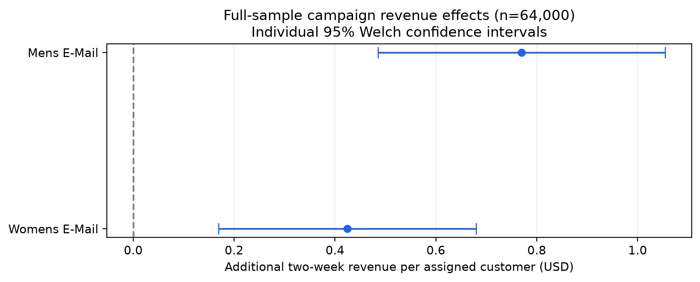
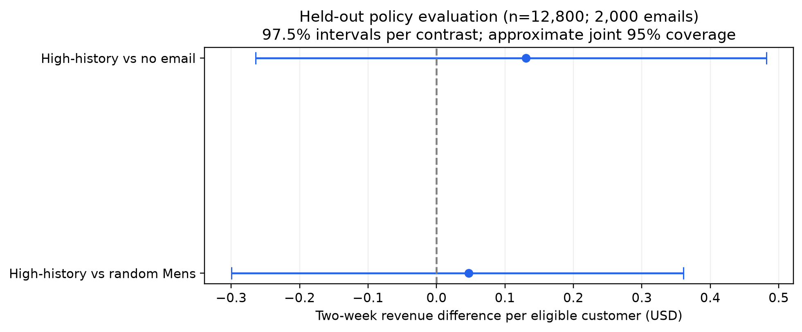

# Hillstrom Email Experiment: Revenue and Targeting

An educational reanalysis of a historical randomized email benchmark, combining experiment diagnostics, revenue inference and capacity-constrained policy evaluation in Python.

**Main result:** both campaigns increased mean two-week revenue versus no email. The validation-selected targeting rule did not establish a clear held-out advantage over uniformly random Mens mailing. The project reports the uncertainty rather than claiming personalization succeeded.

The original experiment and published solutions predate this project. This is a reproducible portfolio analysis, not a newly run experiment or a novel discovery of the benchmark's headline conclusion.

## Campaign effects: full sample

The publisher describes 64,000 customers randomized in thirds to Mens E-Mail, Womens E-Mail or No E-Mail, with outcomes over the following two weeks. The primary metric includes every assigned customer, including those who spent zero.

| Campaign vs no email | Revenue difference per customer (USD) | Individual 95% CI | Relative change | Holm p-value |
|---|---:|---:|---:|---:|
| Mens E-Mail | +0.770 | [+0.485, +1.055] | +117.9% | 2.33e-07 |
| Womens E-Mail | +0.424 | [+0.169, +0.680] | +65.0% | 0.00113 |

Two-sided Welch tests; Holm controls the final two-comparison primary family at 0.05. These confidence intervals are individual 95% intervals. Full-sample estimates were calculated after policy selection and held-out evaluation were locked, and were not used to retune the selected policy.

## Did targeting add value?

Use an illustrative capacity of 10,000 emails per 64,000 eligible customers (15.625%). On validation and test this is 2,000 emails out of 12,800.

Train two T-learner candidates using only pretreatment features, compare them with simple benchmarks, and select by validation IPW mean revenue:

| Strategy | Emails | Validation IPW increment vs no email (USD/customer) |
|---|---:|---:|
| No email | 0 | +0.000 |
| Random Mens E-Mail | 2,000 | +0.156 |
| Random Womens E-Mail | 2,000 | +0.058 |
| High-history Mens | 2,000 | +0.246 |
| Ridge T-learner | 2,000 | +0.069 |
| HGB T-learner | 2,000 | -0.117 |

The selected rule sends Mens to the customers with the largest past-year spend, breaking ties by input order. Freeze that rule and its two comparisons before opening test outcomes.

| Frozen comparison | Difference per eligible customer (USD) | 97.5% interval per comparison |
|---|---:|---:|
| High-history vs No email | +0.131 | [-0.265, +0.482] |
| High-history vs Random Mens | +0.047 | [-0.300, +0.361] |

The two separate 97.5% stratified paired-bootstrap intervals have approximate joint 95% coverage using Bonferroni. Both include zero. The held-out data therefore do not establish superiority over either comparator; they also do not establish zero effect or equivalence.

The general campaign effect and the added value of this constrained targeting rule are different estimands.

## Analysis design

- **Integrity:** verify the input checksum, schema, missingness, binary ranges and outcome coherence. Retain 6,562 extra matching recorded combinations because there is no persistent customer ID proving they are erroneous duplicate people. Normalize only Surburban to Suburban.
- **Experiment health:** allocation diagnostic at 0.001; pretreatment balance by means, proportions and standardized differences.
- **Fixed split:** assignment-stratified 60/20/20 with seeds 42 and 43. Train plus validation supports interim analyses; validation participates in development exploration and selection. Test outcomes are reserved for the frozen evaluation.
- **Revenue inference:** fixed campaign-versus-control hypotheses, Welch intervals and Holm, plus a development percentile bootstrap, shared-cap sensitivity and HC3 regression adjustment.
- **Secondary exploration:** seven development comparisons with BH at q=0.05; three fixed segment-interaction tests with Holm. These are separate exploratory families, not global 5% error control across the project.
- **Policy learning:** Ridge T-learner with alpha 100; one fixed HGB T-learner. Each arm's preprocessing and regression fit only its train rows. Seven inputs describe customers before assignment.
- **Policy evaluation:** IPW with the fixed arm fractions within each stratified evaluation split. These are conditional allocation weights, close to the nominal 1/3, not an outcome-trained propensity model.
- **Random benchmark:** analytically average uniform fixed-capacity recipient lotteries. Revenue is reported per all eligible customers, rather than per mailed customer.

Read the unchanged [original analysis plan](analysis_plan.md), the [decision record](docs/decision_log.md), and the [executed notebook](hillstrom_email_analysis.ipynb).

## Costs and practical interpretation

Actual margins and campaign costs are unavailable. The notebook exports explicitly hypothetical [cost scenarios](outputs/business_scenarios.csv) and [break-even scenarios](outputs/break_even_scenarios.csv).

For example, assume a 40% contribution margin and USD 0.05 per email. If the held-out effect transfers to an illustrative batch of 64,000 customers with 10,000 emails, the selected rule's projected contribution difference versus no email is USD 2,843, with transformed bounds [-7,273, 11,846]. These are scenario projections, not observed profit or a profitability guarantee. Costs and margins are held fixed; the bounds carry only revenue-estimation uncertainty.

Evidence for investing in this targeting rule remains insufficient. A next experiment could compare the fixed rule with random Mens mailing, with a prespecified precision target and observation horizon.

## Reproduce

Tested with Python 3.12.10 and pinned packages in [requirements.txt](requirements.txt). Run from the repository root:

~~~bash
python -m pip install -r requirements.txt
python scripts/download_data.py
python scripts/run_notebook.py
python scripts/validate_project.py
~~~

The download helper checks the mirror's compressed MD5 and SHA-256, then the decompressed CSV SHA-256. Raw data are excluded from Git and the distribution. Review the publisher's terms before use or redistribution; no dataset license is asserted here. See [data instructions](data/README.md).

The notebook already contains cached outputs for review. Headless execution uses a fresh local Jupyter kernel; an interactive Jupyter UI is optional.

The reusable [selected policy](src/policy.py) accepts only pretreatment history:

~~~python
from src.policy import high_history_policy

recommendations = high_history_policy(customers["history"])
~~~

Its index locates analysis records; it is not asserted to identify people.

## Files and validation

| Artifact | Purpose |
|---|---|
| [Executed notebook](hillstrom_email_analysis.ipynb) | Explained analysis and cached outputs |
| [Executive summary](docs/executive_summary.md) | Findings, decision and limits |
| [Results JSON](outputs/results.json) | Cohorts, primary estimates and policy results |
| [Full primary results](outputs/full_primary_revenue.csv) | Final campaign contrasts |
| [Held-out policy results](outputs/test_policy_intervals.csv) | Independent frozen-policy comparisons |
| [Validation strategies](outputs/validation_policy_values.csv) | Exploratory candidate comparison |
| [Selected protocol](outputs/selected_policy.json) | Rule, capacity, comparators and interval settings |
| [Split manifest](outputs/split_manifest.csv) | Source-row split assignments, with no customer-ID claim |
| [Validation report](outputs/validation.json) | Reproduction and consistency checks |
| [Validation notes](docs/validation.md) | What the checks establish |

All 36 code cells completed from a fresh kernel. Numerical checks cover split reproducibility, budget compliance, walkthrough results, final inference, exports and scenario arithmetic. Figures were visually inspected. These checks do not verify the historical randomization or missing customer identities.

## Limits and provenance

This historical two-week experiment does not establish long-term value or contemporary campaign performance. The file lacks persistent IDs, assignment implementation logs, delivery/noncompliance records and timestamps needed to verify follow-up and interference. The analysis relies on the source-described randomized, customer-level design.

Matching profiles are retained under that documented unit assumption; independence cannot be established from row numbers. Spend per buyer is descriptive post-treatment selection, not a causal average-order-value effect. Bootstrap intervals are approximate and condition on the recorded observations and fixed recommendations; models are not refit inside the policy bootstrap.

Data attribution: [Kevin Hillstrom / MineThatData](https://blog.minethatdata.com/2008/03/minethatdata-e-mail-analytics-and-data.html). Acquisition uses the mirror recorded by the [scikit-uplift loader](https://www.uplift-modeling.com/en/latest/_modules/sklift/datasets/datasets.html); checksums are in [provenance.json](data/provenance.json). Its acquisition-stage flag describes the pre-analysis download, not the final project state.

Method references: [Welch inference in SciPy](https://docs.scipy.org/doc/scipy/reference/generated/scipy.stats.ttest_ind.html), [multiplicity methods in statsmodels](https://www.statsmodels.org/stable/generated/statsmodels.stats.multitest.multipletests.html), [T-learners](https://www.pywhy.org/EconML/spec/estimation/metalearners.html), and [Dudik, Langford and Li on off-policy evaluation](https://arxiv.org/abs/1103.4601).
